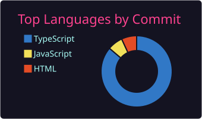
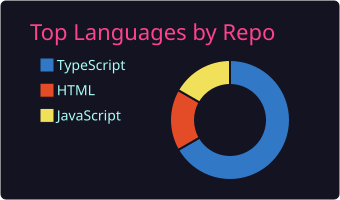
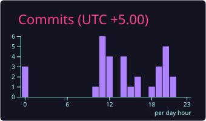

<!-- ============ HEADER ============ -->


<p align="center">
  
  <br/>
  <b>Mobile &amp; AI Engineer</b>
</p>

<p align="center">
  <a href="https://abdul-wahab-dev.netlify.app/">
    
  </a>
</p>

<p align="center">
  <a href="https://abdul-wahab-dev.netlify.app/"></a>
  <a href="https://linkedin.com/in/dev-abdul77"></a>
  <a href="mailto:dev.abdul77@gmail.com"></a>
  
</p>

---

### 👨‍💻 About Me

```typescript
const abdulWahab = {
  role:        "Mobile & AI Engineer",
  currently:   "Mobile Engineer @ Dubizzle Labs",
  basedIn:     "Lahore, Pakistan 🇵🇰",
  shipped:     "5 production apps — App Store & Google Play",
  buildsWith:  ["React Native", "TypeScript", "LLMs", "Speech-to-Text", "VoIP"],
  specialties: [
    "🎙️ Speech-to-note automation",
    "🧠 LLM-powered summaries",
    "💬 Real-time messaging",
    "🔌 Hardware integration",
  ],
  motto:       "Ship it. Measure it. Make it smarter.",
};
```

---

### 🛠️ Tech Arsenal

<p align="center">
  <br/>
  
</p>

<p align="center">
  
  
  
  
  
  
  
  
  
</p>

---

### 🚀 Featured Work

<table>
  <tr>
    <td width="50%" valign="top">
      <h4>🎙️ AI Speech-to-Note</h4>
      Voice → text → LLM-generated summaries, fully automated inside a production mobile app.<br/><br/>
      
      
      <br/><br/>
      <a href="https://abdul-wahab-dev.netlify.app/">View on portfolio →</a>
    </td>
    <td width="50%" valign="top">
      <h4>💬 Real-time Chat Migration</h4>
      Led the move from a custom API chat to Sendbird UIKit — media sharing, voice messages, reactions, replies &amp; message editing.<br/><br/>
      
      <br/><br/>
      <a href="https://abdul-wahab-dev.netlify.app/">View on portfolio →</a>
    </td>
  </tr>
  <tr>
    <td width="50%" valign="top">
      <h4>📞 VoIP Calling Engine</h4>
      Native calling with CallKeep + Linphone SDK, later migrated to WebRTC for better performance &amp; reliability.<br/><br/>
      
      
      <br/><br/>
      <a href="https://abdul-wahab-dev.netlify.app/">View on portfolio →</a>
    </td>
    <td width="50%" valign="top">
      <h4>🏢 Dubizzle Labs</h4>
      Mobile engineer on the team behind apps serving millions of users. 5 production apps shipped across my career.<br/><br/>
      
      <br/><br/>
      <a href="https://abdul-wahab-dev.netlify.app/">See more on portfolio →</a>
    </td>
  </tr>
</table>

---

### 📊 GitHub Analytics

<p align="center">
  
  
</p>

<p align="center">
  
</p>

<p align="center">
  
</p>

---

### 🐍 Contribution Snake

<p align="center">
  <picture>
    <source media="(prefers-color-scheme: dark)" srcset="https://raw.githubusercontent.com/dev-abdulw/dev-abdulw/output/github-snake-dark.svg" />
    
  </picture>
</p>

---

<p align="center">
  <b>💡 Open to collaborations on AI × Mobile — let's build something smart.</b>
</p>


